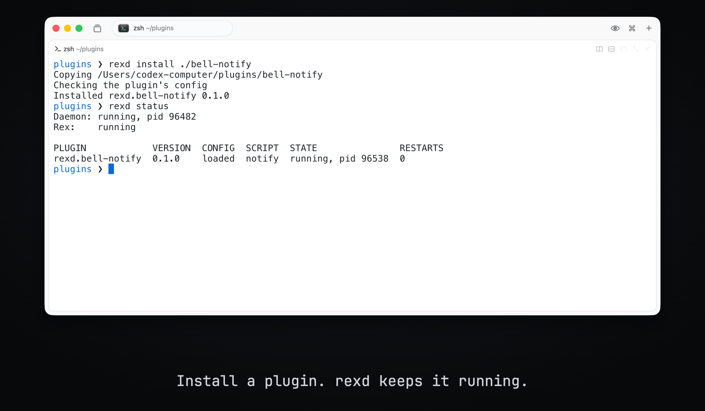
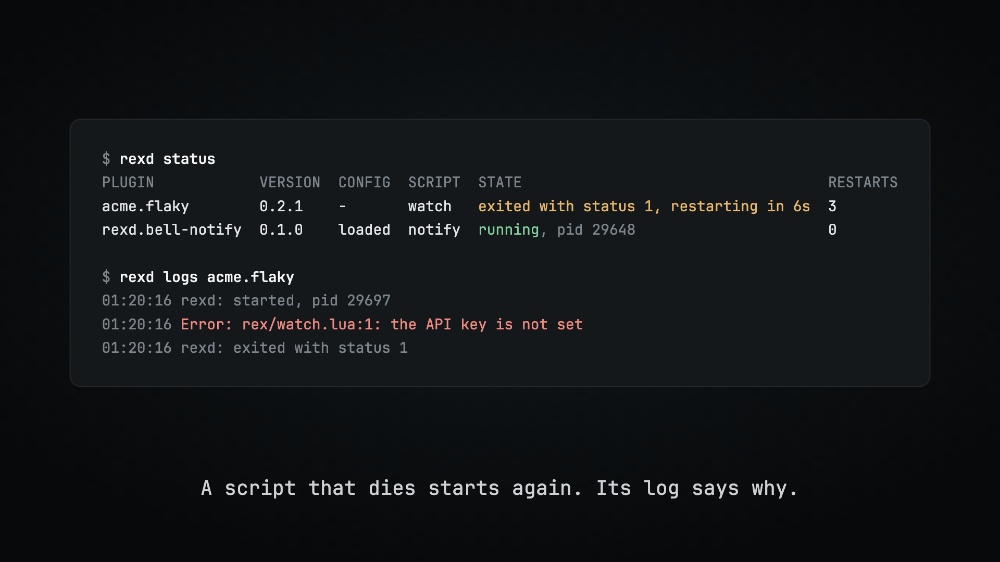
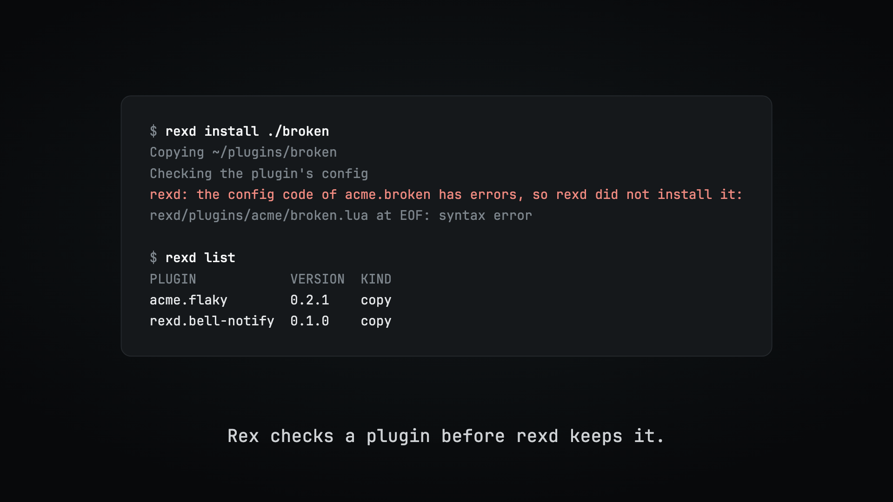

<h1 align="center">rexd</h1>

<h3 align="center">Install plugins for Rex, and keep them running.</h3>

<p align="center">
  
</p>

rexd is a plugin manager and process supervisor for [Rex](https://www.superlogical.com/rex). It installs a plugin from GitHub, adds its config code to Rex, and keeps its event scripts running.

Rex runs plugin code in two places. Config code defines actions and keys, and it has to be in Rex's `init.lua`. Event scripts react to things like a terminal bell, and they only receive events while a `rex do` process stays alive. Rex ships no installer for the first part, and nothing that keeps the second part running.

## Install a plugin with one command

A plugin can come from GitHub, any git URL, or a folder on your machine:

```sh
rexd install owner/repo                  # a GitHub repository
rexd install owner/repo@v1.2.0           # at a branch, tag or commit
rexd install https://gitlab.com/a/b.git  # any git URL
rexd install ./my-plugin                 # a copy of a local folder
rexd install ./my-plugin --link          # a link to it, for development
```

`rexd update` updates every plugin, and `rexd remove` takes one out. Rex reloads its config after each change, so you do not restart anything.

## Event scripts stay alive

The daemon starts each event script and watches it. If a script dies, the daemon starts it again and waits longer after each crash. If you quit Rex, scripts wait until you open it again. rexd never starts Rex.

`rexd status` shows what every script is doing, and `rexd logs` shows why one failed.

<p align="center">
  
</p>

## A broken plugin cannot cost you your setup

rexd edits your Rex config, and these rules protect it:

- **Rex checks every change.** rexd loads a plugin in Rex's own checker before keeping it. If the check fails, every step undoes itself and your config stays as it was.
- **An update never replaces a working version with a broken one.** The new version is built beside the old one, and it only moves into place after it passes the check.
- **One broken plugin stays contained.** If a plugin breaks later, its error stays with it, and your own keys and other plugins keep working. `rexd status` says what is wrong.
- **Your keys win.** `require("rexd")` goes first in `init.lua`. In Rex the newest binding for a key wins, so anything you bind below it overrides a plugin.

<p align="center">
  
</p>

A plugin's build steps and scripts run as you, like any program you install. Install plugins you trust.

## Install

```sh
go install github.com/tornikegomareli/rexd/cmd/rexd@latest
rexd setup
```

`rexd setup` connects rexd to Rex and starts the daemon. It is safe to run again, and it repairs whatever is missing.

`go install` puts `rexd` in your Go bin folder, usually `~/go/bin`. If that folder is not on your `PATH`, choose another one:

```sh
GOBIN="$HOME/.local/bin" go install github.com/tornikegomareli/rexd/cmd/rexd@latest
```

Requirements:

- Rex. rexd finds the `rex` command on your `PATH`, or the copy inside the macOS app. Set `REXD_REX` to use another one.
- Go 1.24 or newer to build it, and git to install plugins from GitHub.
- macOS, Linux or FreeBSD. On macOS, `rexd setup` makes the daemon start at login. On the others, see [Running without a LaunchAgent](#running-without-a-launchagent).

To update rexd itself, run the `go install` command again, then `rexd setup`. `rexd setup` restarts the daemon with the new version.

To try it, install the example plugin:

```sh
git clone https://github.com/tornikegomareli/rexd.git
rexd install ./rexd/examples/bell-notify
```

Ring a bell in any Rex terminal with `printf '\a'`, and a macOS notification names the session.

## Remove

```sh
rexd teardown          # disconnect; plugins stay, and rexd setup brings them back
rexd teardown --purge  # also delete plugins, state and logs
```

Both remove the line from `init.lua`, the generated files and the LaunchAgent.

## Commands

| Command | What it does |
| --- | --- |
| `rexd setup` | Connects rexd to Rex and starts the daemon |
| `rexd install SOURCE` | Installs a plugin |
| `rexd remove PLUGIN` | Removes a plugin |
| `rexd update [PLUGIN...]` | Updates plugins, all of them if none are named |
| `rexd list` | Lists installed plugins |
| `rexd status` | Shows the daemon, plugins and event scripts |
| `rexd logs PLUGIN` | Prints the output of a plugin's event scripts |
| `rexd teardown` | Disconnects rexd from Rex and stops the daemon |
| `rexd daemon` | Runs the daemon in the foreground |

`rexd help COMMAND` shows every flag. `list` and `status` take `--json`.

## Writing a plugin

A plugin is a folder with a manifest, `rex-plugin.toml`:

```toml
id = "acme.bell-notify"
name = "Bell notify"
version = "0.1.0"
rex_api = 7

config = "rex/config.lua"   # actions and keys, loaded into Rex's config

[[scripts]]                 # event scripts the daemon keeps running
name = "notify"
path = "rex/notify.lua"
```

An event script is a normal Rex Lua script that registers handlers:

```lua
rex.on("terminal.bell", function(ctx, ev)
  rex.exec{ "osascript", "-e", 'display notification "Bell!" with title "Rex"' }
end)
```

Develop it with `rexd install ./my-plugin --link`, and run `rexd update acme.bell-notify` to reload it. [`examples/bell-notify`](examples/bell-notify) is a working template, and the [plugin guide](docs/plugins.md) has the full reference.

## What it does to your machine

| Path | What it is |
| --- | --- |
| `~/.config/rex/init.lua` | Your config, with one added line at the top |
| `~/.config/rex/rexd.lua` | Generated, loads every plugin |
| `~/.config/rex/rexd/plugins/` | The plugins' config code |
| `~/.local/share/rexd/plugins/` | Installed plugins |
| `~/.local/state/rexd/` | State, status and logs |
| `~/Library/LaunchAgents/io.github.tornikegomareli.rexd.plist` | Starts the daemon at login |

The two `.local` folders follow `XDG_DATA_HOME` and `XDG_STATE_HOME`.

## Running without a LaunchAgent

Use `rexd setup --no-service`, then keep `rexd daemon` running however you like. For a systemd user service, `~/.config/systemd/user/rexd.service`:

```ini
[Unit]
Description=rexd

[Service]
ExecStart=%h/go/bin/rexd daemon
Restart=always

[Install]
WantedBy=default.target
```

rexd has only been tested on macOS so far. It builds on Linux and FreeBSD, and CI runs its unit tests on Linux.

## Limits

- An event script can only start once Rex has at least one session. It misses events from before it started.
- A plugin's config code is one file, because Rex's `require` only finds files beside `init.lua`.
- Windows is not supported. rexd uses Unix signals and file locks.

## How it works

The [architecture notes](docs/architecture.md) explain the design, and the Rex behavior it is built on. Each fact there was measured against a real Rex server.

## Development

```sh
make install   # build this checkout and put it in your Go bin folder
make test      # unit tests, with the race detector
make e2e       # end-to-end tests against a real Rex
make e2e-race  # the same, with a race-enabled rexd
make lint      # gofmt and go vet
```

The end-to-end tests need Rex installed. Each test starts its own server with a temporary socket, state and config, and it checks the server's config path before doing anything else, so they can run while you work in Rex. They use launchd for real, under labels of their own.

## License

[MIT License](LICENSE).
